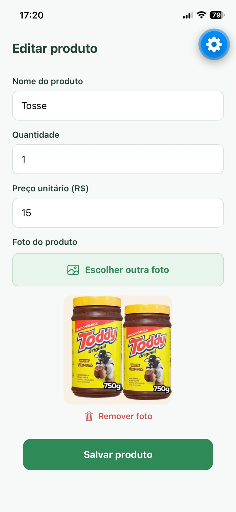
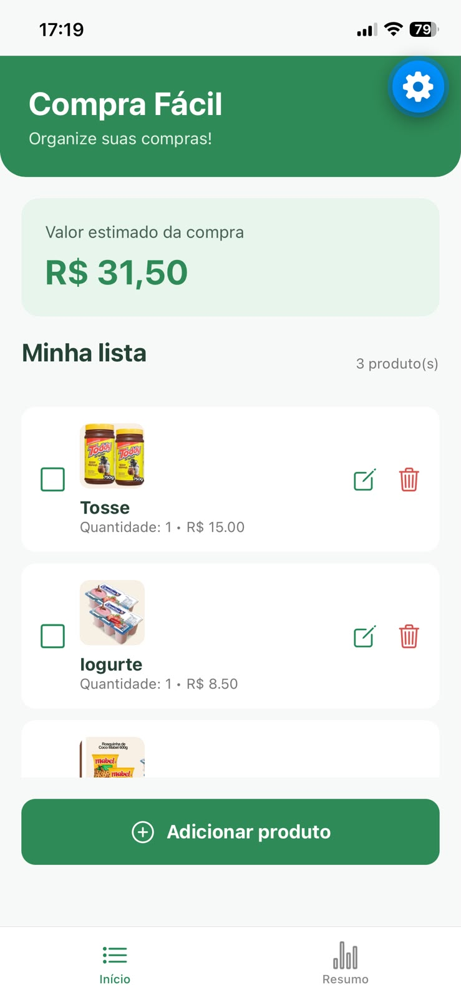

# Compra Fácil

Aplicativo mobile desenvolvido para criar e organizar listas de compras, acompanhar produtos comprados e consultar o valor estimado das compras. O projeto foi desenvolvido com React Native, Expo, React Navigation e Firebase Firestore.

## Funcionalidades

- Cadastro, edição e exclusão de produtos.
- Registro de quantidade e preço unitário.
- Cálculo do valor total estimado da lista.
- Marcação de produtos como comprados.
- Resumo de produtos pendentes e comprados.
- Seleção de fotos pela galeria do dispositivo.
- Navegação com Native Stack e Bottom Tabs.
- Gerenciamento de estado compartilhado com Context API.
- Autenticação anônima e sincronização em tempo real com Cloud Firestore.

## Tecnologias utilizadas

- React Native e Expo SDK 58.
- React Navigation 7 (Native Stack e Bottom Tabs).
- Firebase JavaScript SDK.
- Firebase Authentication.
- Cloud Firestore.
- Expo Image Picker.
- Expo Vector Icons.
- AsyncStorage para persistência da sessão de autenticação.

## Requisitos para execução

- Node.js 24.12.0 ou superior.
- npm.
- Aplicativo Expo Go compatível com o SDK do projeto ou emulador/dispositivo configurado.
- Projeto Firebase com Authentication anônimo habilitado e Cloud Firestore criado.

## Instalação e execução

1. Baixe ou clone este repositório.
2. Abra um terminal dentro da pasta `app`, onde está localizado o arquivo `package.json`.
3. Instale as dependências:

```bash
npm ci
```

4. Confira as configurações e a compatibilidade do projeto:

```bash
npx expo-doctor
```

5. Inicie o aplicativo:

```bash
npx expo start
```

6. Leia o QR Code com o Expo Go compatível ou pressione `a` para abrir no emulador Android configurado.

## Configuração do Firebase

Para executar o aplicativo, é necessário configurar um projeto Firebase.

1. Acesse o [Firebase Console](https://console.firebase.google.com/) e abra o projeto utilizado no desenvolvimento ou crie um projeto de teste.
2. Acesse **Authentication > Sign-in method** e habilite o método de autenticação **Anonymous**.
3. Acesse **Firestore Database** e crie o banco de dados.
4. Abra **Firestore Database > Rules** e publique as regras disponíveis no arquivo `firestore.rules`, localizado na raiz do repositório.
5. Em **Configurações do projeto > Seus apps**, registre ou consulte um aplicativo Web e obtenha as configurações do Firebase.
6. Confira os valores de configuração no arquivo `app/src/firebase.js`. Caso utilize outro projeto Firebase, substitua os valores pelas configurações correspondentes.
7. Execute novamente o aplicativo e teste as operações de cadastro, leitura, edição e exclusão de produtos.

**Importante:** a configuração do Firebase contém identificadores e uma chave de API do projeto. Esses dados não substituem as regras de segurança do Firestore. Nunca inclua credenciais privadas de servidor ou arquivos de service account no aplicativo.

## Observação sobre as fotos

Nesta versão, o aplicativo armazena a URI local retornada pela galeria do dispositivo. A imagem pode ser visualizada no mesmo dispositivo enquanto o arquivo local continuar disponível, mas não é realizado upload para a nuvem.

Para disponibilizar as mesmas fotos em outros dispositivos, será necessário integrar o Firebase Storage e armazenar no Firestore a URL de download da imagem.

## Estrutura do repositório

```text
compra-facil-feature-telas-iniciais/
├── README.md
├── firestore.rules
├── docs/
│   └── screenshots/
│       ├── tela-inicial.png
│       ├── cadastro-produto.png
│       └── resumo.png
└── app/
    ├── App.js
    ├── app.json
    ├── index.js
    ├── package.json
    ├── package-lock.json
    ├── src/
    │   ├── context/ProductsContext.js
    │   ├── navigation/AppNavigator.js
    │   ├── screens/
    │   ├── styles/index.js
    │   └── firebase.js
    └── assets/
```

## Controle de versão e Git Flow

O projeto está versionado em um repositório Git. Durante o desenvolvimento, foi utilizada a branch `feature/telas-iniciais`, na qual as alterações foram registradas em commits e enviadas ao repositório remoto.

A organização do fluxo Git Flow considera as seguintes branches:

- `main`: versão estável do projeto.
- `develop`: integração das funcionalidades desenvolvidas.
- `feature/nome-da-funcionalidade`: desenvolvimento de funcionalidades específicas.

Fluxo recomendado para o desenvolvimento:

```bash
git checkout develop
git pull origin develop
git checkout -b feature/nome-da-funcionalidade

git add .
git commit -m "feat: descreve a funcionalidade"
git push -u origin feature/nome-da-funcionalidade
```

Após a implementação e os testes, as alterações podem ser integradas à branch `develop`. Quando a versão estiver finalizada e validada, ela poderá ser integrada à branch `main`.

Por se tratar de um projeto individual, os commits registram as etapas e alterações realizadas durante o desenvolvimento.

## Integrante e responsabilidades

| Integrante | Responsabilidades |
|---|---|
| Isabele de Souza Pereira | Desenvolvimento do Compra Fácil, criação das telas, navegação, gerenciamento de estado, integração com Firebase, implementação das funcionalidades e testes do aplicativo. |

## Capturas de tela

### Tela inicial


### Cadastro de produto



### Resumo de compras



## Demonstração final

O aplicativo será apresentado ao vivo, com demonstração das principais funcionalidades:

- Cadastro de produtos.
- Edição e exclusão de produtos.
- Marcação de produtos como comprados.
- Consulta ao resumo das compras.
- Sincronização dos dados com o Firebase Firestore.
